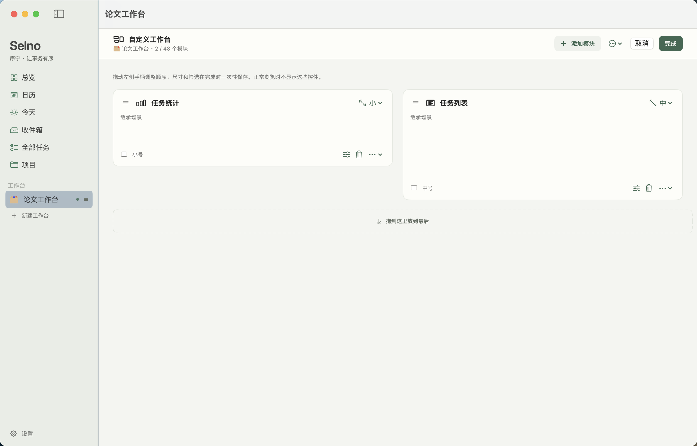
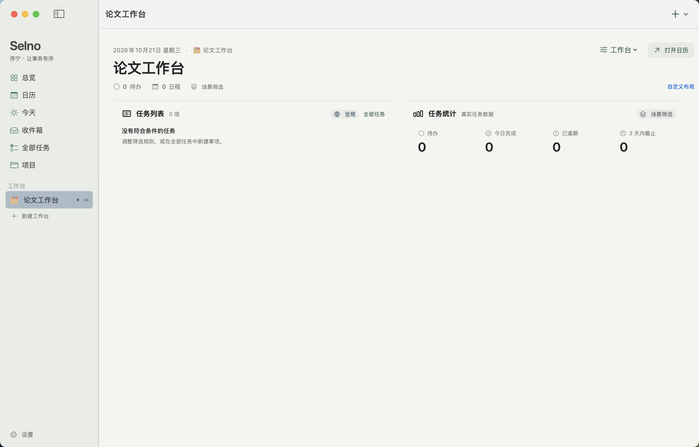
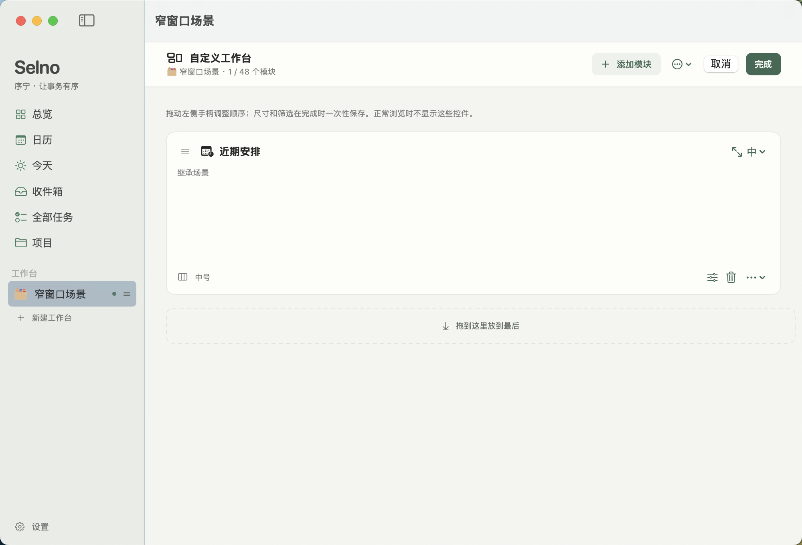
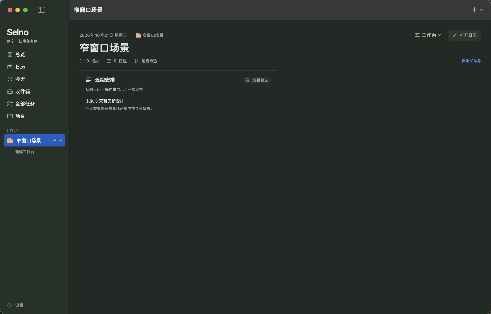

# Selno · 序宁｜Phase 05 工程交付报告

日期：2026-10-21。基于现有工程增量开发，没有重建项目，没有 Commit 或 Push。

本轮目标是「自适应工作台」：在同一个本地 SwiftData 数据源之上增加场景化工作台，升级总览，提供可编辑的模块布局、可复用任务筛选与 JSON v2。实现遵循既有 Quiet Structure / SelnoDesign 语义，没有删除或绕过已有任务、日历、项目、模板、提醒和备份功能。

> **验证状态说明**：本报告的「已验证」只表示有实际命令输出或测试结果支持；「已实现但未完整验证」表示代码已编译、但缺少人工体验验收或大规模性能实测；「未完成」表示本轮未取得结果。Phase 05 的 4 条 UI 验收用例与既有回归用例已在最终代码上执行（共 20 次，0 失败），真实截图从通过的 `.xcresult` 导出。详见第 11、12、13 节。

## 1. Phase 05 实际完成范围

### 1.1 已完成并验证

- V5 Schema 与迁移链：新增 `Workspace`、`WorkspaceModule`、`SavedTaskView`，V4 → V5 为轻量迁移；历史 V1–V4 定义未原地修改。
- 全局工作台的幂等初始化：首次启动创建一个全局工作台与 7 个默认模块；重复启动、迁移后启动和已有场景的库都不会重复创建；全局工作台不可删除。
- 工作台生命周期服务：创建、重命名、改 Emoji／强调色、复制、排序、删除、恢复全局默认布局；删除场景只删除工作台与模块配置。
- 八个内置模块及其真实数据视图：今日聚焦、近期安排、紧凑月历、收件箱、项目进度、任务列表、任务统计、快捷操作。
- 确定性响应式布局：840 / 1180 断点，最多三列，行装箱、跨度、稳定宽度，未知模块保存原始配置。
- 独立编辑模式：草稿、拖动排序、尺寸菜单、筛选配置、移除、添加、取消丢弃、完成时单事务保存、失败回滚。
- 结构化任务筛选：状态、重要性、项目、标签、日期范围、截止状态、计划状态、归档、搜索；同一维度 OR，跨维度 AND；继承、全局、自定义三种数据范围；已保存任务视图。
- 侧边栏场景区：创建、复制、重命名与筛选、上移／下移、拖拽排序、删除；总览不重复出现。行本身保持普通选择目标，只有尾部小握柄是拖拽源，避免 AppKit 把整行当作拖拽源后吞掉切换点击。
- 模块拖拽与侧边栏拖拽使用独立载荷：模块为 `public.json`、工作台为 `public.xml`，并与日历使用的纯文本拖拽互不匹配；落点还会校验载荷类型与发起拖拽时的 UUID，陈旧状态不能改变顺序。
- JSON 备份 v2：工作台、模块布局、任务视图与筛选规则；v1 读取；合并幂等；替换前安全备份；未来版本与非法引用拒绝。
- 单元测试：完整套件 136/136 通过（18 个 Suite）；其中 Phase 05 4 个 Suite、49 条测试通过；布局测试覆盖 10／30／100 个模块与三档宽度。
- UI 测试：最终代码上 20 次执行全部通过（19 个独立测试方法；启动测试按 target application 配置运行 2 次），其中 Phase 05 4/4、既有回归 16/16；Phase 05 用例覆盖创建、添加、调整尺寸、模块拖动、筛选、切换、取消、重启、侧栏重排、深浅色与窄窗口。
- 真实历史库副本迁移：对正式 V4 库的字节级副本（含 WAL）执行 V4 → V5，迁移前 1 个任务、1 个项目、5 个分类、4 个模板全部保留；迁移本身不创建配置，随后种子只创建 1 个全局工作台与 7 个模块，重复种子不增加，关闭重开仍为 1／7。副本位于临时目录，验收后删除，个人数据未写入仓库。
- 真实运行截图：4 张，均从通过运行的 `.xcresult` 导出，位于 `Docs/Phase05Screenshots/`。
- Debug 测试构建与 Release 签名构建成功；Bundle Identifier 保持 `com.yexiaonan.Selno`；未关闭代码签名。

### 1.2 已实现但尚未完整验证

- 深色／浅色、Reduce Motion、VoiceOver、键盘重排与真实鼠标拖拽的最终视觉效果和手感仍需要人工验收；自动化测试只能验证标识、布局数值与合成事件路径。
- 提交到仓库的迁移测试使用由冻结 V4 Schema 生成的磁盘库；另有一次性离线验收在真实库副本上通过，但该副本包含个人数据，未作为固定测试夹具提交。
- 10／30／100 个模块的布局有算法级测试，但没有在真实窗口中长时间测量大量模块的滚动与重绘成本。
- 已保存视图被删除后，模块回退到场景筛选的行为有单元测试，但界面上没有「视图已删除」的显式提示。

### 1.3 未完成

- 在真实显示器、VoiceOver 与真实鼠标环境下的人工验收记录。
- 真实窗口中的 10／30／100 模块性能测量。

## 2. 核心架构设计

### 2.1 单一业务数据源

工作台不持有任务、项目、标签、日程或模板的副本。所有模块通过 SwiftData 查询同一份本地业务数据；工作台只保存展示配置：

- 名称、Emoji、强调色、顺序。
- 默认筛选规则（JSON 编码的 `TaskFilterExpression`）。
- 模块列表：类型、尺寸、顺序、数据范围、可选的已保存视图、模块配置。
- 创建与更新时间。

复制工作台会生成新的工作台与模块 UUID，但不会复制或关联复制任何业务记录。删除场景只删除 `WorkspaceModule` 与 `Workspace` 行；任务、项目、标签、日程和模板不受影响。

### 2.2 视图与状态分层

- `WorkspaceBoardView`：全局与场景共用的入口；负责普通浏览态、编辑态、草稿、保存错误和侧边栏删除后的回退。
- `WorkspaceEditBoard`：只编辑 `[WorkspaceModuleSnapshot]` 草稿；拖动、尺寸、配置、移除都在内存中完成。
- `WorkspaceService`：所有写操作的唯一入口。校验、插入、删除、排序和一次 `context.save()`；失败执行 `context.rollback()`。
- `WorkspaceDataQuery` / `WorkspaceBoardQueryPlan`：每个工作台一次性生成查询计划，合并模块所需日期窗口；`WorkspaceBoardData` 在内存中按筛选缓存任务、节点、月历和投影。
- `WorkspaceSnapshot` / `WorkspaceModuleSnapshot`：从 SwiftData 模型读取的不可变值类型，避免视图在编辑期间直接修改持久化对象。
- `TaskFilterExpression`：独立、可 Codable、可 Hashable 的筛选值对象，同时被工作台默认筛选、模块自定义筛选和已保存任务视图复用。
- `WorkspaceDragType`：模块与侧边栏工作台各有独立拖拽类型和 JSON／XML 载荷；接收端校验载荷种类与发起时的 UUID，因此不会与日历任务拖拽、普通文本或陈旧拖拽状态串线。
- `WorkspaceFilterDisclosure`：编辑与创建界面共用的整行筛选展开控件，整行可点击、可聚焦，替代 macOS 上只有小三角可展开的原生 `DisclosureGroup`。

### 2.3 导航

`MainWindowView` 使用 `SidebarSelection` 区分固定页面与场景工作台：

- `.section(.overview)` 始终代表全局工作台，渲染 `WorkspaceBoardView(workspaceID: nil, ...)`。
- `.workspace(UUID)` 渲染对应场景。
- 侧边栏固定入口仍为总览、日历、今天、收件箱、全部任务、项目；场景工作台在独立分组中显示，不重复「总览」入口。
- 替换导入后会回到 `.section(.overview)`，避免选择已被替换的场景 ID。

### 2.4 兼容策略

- 历史 Schema 文件保持冻结；V5 只新增实体，没有修改业务实体字段。
- 未知模块类型按原始 `kindRaw`、`sizeRaw`、`scopeRaw` 与 `configData` 保存，在界面上显示为不可解析的占位模块；不会因未知类型丢弃整块布局。
- JSON v1 文件继续可读；v2 新增字段缺失时使用安全默认值。
- 总览继续沿用既有的 `dashboard.*` 标识，减少既有 UI 测试和用户习惯的破坏。

## 3. Workspace 与 Module 数据模型

### 3.1 Workspace

`Workspace`（SwiftData `@Model`）：

| 字段 | 类型 | 说明 |
| --- | --- | --- |
| `id` | UUID | 稳定标识 |
| `name` | String | 显示名称，最多 30 个字符 |
| `emoji` | String | 最多 8 个字符 |
| `accentRaw` | String | 六种低饱和强调色之一 |
| `sortOrder` | Int | 全局为 0；场景从 1 开始 |
| `isGlobal` | Bool | 全局工作台标记 |
| `filterData` | Data? | `TaskFilterExpression` 的确定性 JSON |
| `createdAt` / `updatedAt` | Date | 时间戳 |
| `modules` | `[WorkspaceModule]` | cascade 关系，删除工作台时只清理配置 |

约束：全局工作台不可删除；最多 24 个工作台；场景排序由服务规范化；名称、Emoji、筛选和强调色在保存前校验。

### 3.2 WorkspaceModule

| 字段 | 类型 | 说明 |
| --- | --- | --- |
| `id` | UUID | 稳定标识 |
| `kindRaw` | String | 原始模块类型；未知值保留 |
| `sizeRaw` | String | 原始尺寸；已知模块会修复到支持尺寸 |
| `sortOrder` | Int | 逻辑顺序 |
| `scopeRaw` | String | `inherit` / `global` / `custom` |
| `savedViewID` | UUID? | 已保存任务视图 |
| `configData` | Data? | 容错 Codable 配置：筛选、天数、数量、排序 |
| `createdAt` / `updatedAt` | Date | 时间戳 |
| `workspace` | Workspace? | 反向关系 |

`WorkspaceModuleConfig` 使用容错解码：缺失字段使用默认值，非法筛选经过 `sanitized()` 修复。写入时使用 `encoded(preserving:)`：只替换四个已知字段，未来版本放在同一对象里的其他键与筛选对象中的未知键原样保留；未知模块则完全保留原始字节。这样调整尺寸或顺序不会悄悄删除未来字段。

### 3.3 SavedTaskView

`SavedTaskView` 保存可复用的名称、Emoji、颜色、筛选、排序和数量。模块引用已保存视图时，数据范围固定为 `custom`；删除视图会让引用模块回退到场景筛选，并在启动修复中清除悬空引用。任务视图管理位于「设置 → 任务视图」，不新增一级侧边栏入口。

### 3.4 预设与默认布局

- 场景预设：空白、校园、开发、生活、复制现有。
- 全局默认布局：今日聚焦（大）、近期安排（中，7 天）、紧凑月历（中）、收件箱（中）、项目进度（中）、任务统计（小）、快捷操作（小）。
- 全局名称「全局工作台」，Emoji「🧭」；全局可按用户自定义，也可恢复默认布局。

### 3.5 上限与修复

`WorkspaceLimits`：24 个工作台、每工作台 48 个模块、任务列表 1…50 项、查询回溯 180 天、前瞻 365 天、最大跨度 550 天。

启动时 `WorkspaceSanitizer` 只修复配置行：补齐空名称／Emoji、纠正非法颜色与范围、把不支持的尺寸改回默认值、清除悬空的已保存视图、重新编号顺序。它从不读取或修改任务、项目、标签、日程或模板。

## 4. V5 Schema 与迁移结果

### 4.1 Schema

- V1：Phase 01 的 5 种类型，冻结在 `SelnoSchemaV1Models.swift`。
- V2：Phase 02 的 6 种类型，冻结在 `SelnoSchemaV2Models.swift`。
- V3：Phase 03 的模板、实例、节点与多标签关系，冻结在 `SelnoSchemaV3Models.swift`。
- V4：`TodoTask.archivedAt` 与 `TaskReminder`；V4 使用当前业务模型定义，Phase 05 没有修改这些字段。
- V5：新增 `Workspace`、`WorkspaceModule`、`SavedTaskView`，业务实体与 V4 相同。

`SelnoMigrationPlan` 当前链：

1. V1 → V2 lightweight。
2. V2 → V3 custom（把旧单一分类镜像到多标签）。
3. V3 → V4 lightweight。
4. V4 → V5 lightweight。

V5 迁移阶段只增加表，不写入默认工作台。默认工作台由 `AppBootstrap` 在容器打开后调用 `WorkspaceSeeder.seedIfNeeded` 写入，确保迁移本身不修改用户配置，也避免重复启动产生第二份全局。

### 4.2 实际迁移测试与结果

`SelnoTests/Phase05MigrationTests.swift` 覆盖：

- 使用冻结的 `SelnoSchemaV4` 在临时目录实际写入一个 V4 磁盘库（包含任务、项目、分类、标签、模板、节点、日程和提醒），退出写入容器，再通过正式 `PersistenceController.makeContainer(storage: .disk(...))` 打开；该过程触发真实的 V4 → V5 磁盘迁移，而不是同版本重开。
- 迁移后业务行数量、UUID、状态、重要性、日期、项目、分类、多标签、节点、日程、模板和提醒全部保留。
- 迁移本身不创建任何 `Workspace` / `WorkspaceModule` / `SavedTaskView`；随后启动种子创建一个全局与 7 个模块；再次调用种子不增加行。
- 第二次真实打开同一文件，数据与全局布局仍在，模块顺序与默认规格一致。
- V4 迁移后的库导出 v2 备份，再在干净内存库中替换恢复，工作台与任务完整往返。
- 已有场景但缺少全局的库，在首次启动时补建全局，同时保留场景布局并重新编号。

本轮实际结果：`Phase05MigrationTests` 3/3 通过（包含在最终完整套件 136/136 中）。没有删除数据库，没有修改用户正式库，没有通过关闭持久化规避迁移。

除提交到仓库的测试外，本轮还对这台机器上正式应用的 V4 库做了一次离线副本验收：把 `Selno.store`、`-wal`、`-shm` 字节复制到临时目录，再用正式 `PersistenceController.makeContainer(storage: .disk(...))` 打开副本。由于沙盒测试宿主不能直接写 `/tmp`，测试再把副本复制进应用容器临时目录后执行迁移。结果：

- 迁移前库中没有 `Workspace` 相关表；业务行为 1 个任务、1 个项目、5 个分类、4 个模板。
- 迁移本身不创建 `Workspace`，上述各项行数保持不变。
- 调用一次种子后为 1 个全局工作台与 7 个模块；再次调用不增加。
- 关闭容器后重新打开，仍是 1 个全局、7 个模块和原有业务行。

该副本包含个人数据，只在临时目录中存在，验收后已删除，没有作为测试夹具提交。这样既验证了真实历史库的迁移路径，也没有把用户数据写入仓库。

## 5. 布局算法和响应式策略

### 5.1 断点与列数

| 可用宽度 | 列数 |
| --- | --- |
| < 840 | 1 |
| 840…1179 | 2 |
| ≥ 1180 | 3 |

宽度先由 `WorkspaceLayoutEngine.contentWidth(for:)` 限制在 0…1500 点；工作台内容区域还会扣除 52 点内边距。布局最多三列，窗口最小宽度为 1000，因此不会出现第四列或横向溢出。

### 5.2 跨度

- 小：占 1 列（任何列数）。
- 中：在 1 列时占 1 列；在 2／3 列时占 1 列。
- 大：在 1 列时占 1 列；在 2 列时占 2 列；在 3 列时占 3 列。

跨度在运行时还会被当前列数截断，因此「大」模块在窄窗口自动变成整行，而不是按绝对像素固定宽度。

### 5.3 行装箱

模块按持久化逻辑顺序依次放入当前行；当剩余列数不足时换行。编辑器与浏览态复用同一个引擎，只有卡片高度与编辑控件不同。每行使用 `HStack`，宽度由 `entryWidth` 计算，间距固定 18 点；不使用绝对 `position` 或窗口坐标，因此布局只由「顺序 + 尺寸 + 宽度断点」决定。

单元测试验证：

- 每个尺寸在所有断点下的跨度。
- 任意模块序列的单元格不重叠、不超出列数。
- 10、30、100 个模块在一列、两列、三列三档宽度下布局仍然确定、有界且不重叠。
- 未知模块与原始配置在复制、保存、重启后保留；已知模块配置中的未来键也不会因调整尺寸或顺序被删除。

### 5.4 编辑模式与动画

- 浏览态不渲染拖动手柄、尺寸菜单、移除按钮或添加入口。
- 编辑态顶部提供添加、更多、取消、完成；每个卡片提供拖动手柄、尺寸菜单、配置、移除、移动菜单与辅助功能动作。
- 拖拽只修改草稿顺序；插入指示器在目标卡片左侧显示；拖到末尾有独立放置区。
- 使用 `Reduce Motion` 时关闭动画。
- 取消不写入；完成调用一次 `saveLayout`；保存失败回滚并保留草稿供重试。

## 6. 筛选规则与数据范围处理

### 6.1 维度与组合

`TaskFilterExpression` 的维度：

- 状态集合。
- 重要性集合。
- 项目集合 + 是否包含未归属项目。
- 标签集合（包含旧单一分类）。
- 日期字段：任意日期 / 截止日期 / 计划日期。
- 日期范围：不限、今天、未来 3 天、未来 7 天、本周、本月、自定义。
- 截止状态：不限、有截止、无截止、已逾期、未逾期。
- 计划状态：不限、有计划日期、无计划日期。
- 是否包含已归档。
- 搜索文本（标题、备注、项目、标签、旧分类）。

同一维度内的多个值是 OR；不同维度之间是 AND。例如「状态=待开始或进行中」且「重要性=重要」且「标签=课程或比赛」。

### 6.2 日期语义

- 所有日期使用调用方传入的当前 `Calendar` 与 `TimeZone`。
- 「今天」「未来 3 天」「本周」「本月」均由 `calendar.dateInterval` / `startOfDay` 计算，不截取 UTC 字符串，也不使用固定 86 400 秒。
- 自定义范围包含起止两天：开始取开始日的本地午夜，结束取结束日次日的本地午夜，按半开区间匹配。
- 逾期判定为 `dueAt < 今天本地午夜`；截止日期在今天任意时刻都不算逾期。
- 查询计划按整块板合并所需窗口，并限制在回溯 180 天、前瞻 365 天与最长 550 天内；超出范围的旧完成记录仍在数据库中，只是不进入有界板查询。

### 6.3 数据范围

模块范围：

- `继承场景`：使用工作台默认筛选。
- `全局数据`：使用 `.unrestricted`，忽略场景筛选。
- `自定义筛选`：使用模块自己的完整规则，**替代**场景筛选，而不是与场景规则再取 AND。

已保存任务视图优先于模块范围：选中视图后模块规则来自视图，范围固定为自定义；删除视图会清除模块引用，避免悬空。

页面显示筛选来源：「场景筛选：…」「全局筛选」「自定义」。模块卡片在编辑态显示范围说明与视图名称。

### 6.4 筛选测试

`Phase05FilterTests` 11 条测试覆盖：维度内 OR、维度间 AND、项目与未归属、标签与旧分类、搜索、日历／时区日期范围、截止与计划状态、归档、清洗、非法范围、确定性 Codable、摘要文本。全部通过。

## 7. 官方模块清单

| 模块 | 分类 | 支持尺寸 | 说明 |
| --- | --- | --- | --- |
| 今日聚焦 | 聚焦 | 中 / 大 | 逾期、今天截止、重要性排序；复用 `DashboardProjection` |
| 近期安排 | 日历 | 中 / 大 | 未来 3 / 7 天，每件事只显示下一次承诺 |
| 紧凑月历 | 日历 | 中 / 大 | 本月任务与日程标记，可打开日历 |
| 收件箱 | 任务与项目 | 小 / 中 / 大 | 未安排任务快照与快速记下想法 |
| 项目进度 | 任务与项目 | 小 / 中 / 大 | 未归档项目的完成比例与逾期数量 |
| 任务列表 | 任务与项目 | 中 / 大 | 按筛选、排序、数量展示任务；可绑定已保存视图 |
| 任务统计 | 聚焦 | 小 / 中 | 待办、今日完成、逾期、临近截止 |
| 快捷操作 | 快捷操作 | 小 / 中 | 新建任务、从模板创建、新建日程、进入今天 |

模块目录只列出这八个内置模块，按「聚焦」「任务与项目」「日历」「快捷操作」分组，没有插件市场或网络入口。目录提供本地搜索；添加模块只写配置，不复制业务数据。

## 8. JSON V2 兼容性

### 8.1 格式

- 格式标识仍为 `com.yexiaonan.selno.backup`。
- `schemaVersion` 从 1 升到 2。
- `data` 新增：`workspaces`、`savedViews`；每个工作台内包含模块布局、筛选原始字节与配置。
- 既有实体字段保持 v1 结构；日期仍为 ISO 8601 UTC，UUID 稳定，集合按 UUID 排序。
- 模块的未知 `kind`、`size`、`scope` 与 `configRawBase64` 原样保存；无法识别的未来内容不会被重写。

### 8.2 读取与导入

- v1：缺少 `workspaces` / `savedViews` 时解码为空数组；导入后在缺少全局工作台时补建一个，既有任务数据完整恢复。
- v2：完整解码工作台、模块与任务视图；模块与工作台、已保存视图的引用在写入前校验。
- 未来版本：`schemaVersion > 2` 直接拒绝，不猜测、不降级写入。
- 重复 ID、空名称、非法 Base64、非有限日期、非法自定义范围、重复工作台 ID、多个全局、悬空模块引用都会在写入前拒绝。
- 合并：按 UUID 匹配；本地冲突保留本地版本；已有全局时跳过导入的全局；模块与视图的引用保持有效；重复导入同一文件不产生重复行。
- 替换：先写 `Selno-PreRestore-<时间戳>.json` 安全备份；在单个事务中删除旧配置与业务行、插入备份内容；失败回滚；成功后再校验。
- 导出只读取 context，不插入、不更新、不保存。

### 8.3 测试结果

`Phase05BackupTests` 10/10 通过，覆盖：v2 导出内容、导出不修改 context、替换恢复含未知模块、v1 导入补全局、幂等合并、视图 UUID 冲突、替换安全备份与注入失败回滚、非法引用与畸形元素拒绝、未来版本拒绝、已知配置修复与未知模块保留。

## 9. 新增与修改文件列表

### 9.1 新增

| 文件 | 职责 |
| --- | --- |
| `Selno/Features/Workspace/WorkspaceBoardView.swift` | 全局／场景工作台、编辑态、草稿、模块卡片 |
| `Selno/Features/Workspace/WorkspaceDataQuery.swift` | 查询计划、板级数据、统计、筛选解析 |
| `Selno/Features/Workspace/WorkspaceLayoutEngine.swift` | 断点、跨度、行装箱、宽度 |
| `Selno/Features/Workspace/WorkspaceModuleRegistry.swift` | 八个模块的描述、尺寸、默认配置 |
| `Selno/Features/Workspace/WorkspaceModuleCatalog.swift` | 模块目录与模块配置面板 |
| `Selno/Features/Workspace/WorkspaceModuleViews.swift` | 各模块真实数据视图与快捷操作 |
| `Selno/Features/Workspace/WorkspaceEditorViews.swift` | 工作台创建与编辑、恢复默认、删除确认 |
| `Selno/Features/Workspace/TaskFilterEditor.swift` | 筛选编辑器与颜色／标签选择 |
| `Selno/Features/Workspace/WorkspaceDragTypes.swift` | 模块与工作台的独立拖拽类型、载荷编码与 UUID 校验 |
| `Selno/Models/Workspace.swift` | Workspace、WorkspaceModule、SavedTaskView 与快照 |
| `Selno/Models/WorkspaceEnums.swift` | 尺寸、范围、模块类型、分类、强调色、上限 |
| `Selno/Models/TaskFilterExpression.swift` | 筛选表达式、清洗、匹配、范围与摘要 |
| `Selno/Services/WorkspaceService.swift` | 工作台／模块／视图服务、种子与修复 |
| `Selno/App/WorkspaceSidebarView.swift` | 侧边栏场景区与操作菜单 |
| `SelnoTests/Phase05WorkspaceTests.swift` | 工作台生命周期、布局、模块、视图、查询 |
| `SelnoTests/Phase05FilterTests.swift` | 筛选语义、日期、Codable、摘要 |
| `SelnoTests/Phase05MigrationTests.swift` | V4 → V5 磁盘迁移、种子幂等、v2 往返 |
| `SelnoTests/Phase05BackupTests.swift` | v1/v2 导出导入、合并、替换、回滚 |
| `SelnoUITests/Phase05UITests.swift` | 四条 Phase 05 UI 验收用例 |
| `Docs/Phase05Screenshots/` | 从通过运行导出的四张真实运行截图 |
| `Docs/Phase05-Report.md` | 本报告 |

### 9.2 修改

- `Selno/Persistence/SelnoSchema.swift`：V4、V5 定义与迁移阶段。
- `Selno/Persistence/PersistenceController.swift`：使用 V5 Schema；测试库自动备份目录。
- `Selno/App/AppBootstrap.swift`：启动时幂等写入全局工作台。
- `Selno/App/AppSection.swift`：`SidebarSelection` 与固定分区。
- `Selno/App/MainWindowView.swift`：全局／场景路由、数据替换后的回退。
- `Selno/Features/Settings/SettingsWorkspace.swift`：「任务视图」设置页。
- `Selno/Backup/BackupModels.swift`、`BackupCodec.swift`、`BackupExportService.swift`、`BackupImportService.swift`：v2 DTO、校验、导出、合并／替换。
- `Selno/Features/Dashboard/DashboardWorkspace.swift`：复用紧凑月历；收件箱排除已归档。
- `Selno/Features/Dashboard/DashboardDataQuery.swift`：逾期待办排除已归档。
- `Selno/Models/TaskEnums.swift`：把筛选需要的枚举标记为 `nonisolated`。
- `Selno/Shared/Components/SelnoDesign.swift`：暴露自适应颜色给工作台强调色。
- `Selno/Features/Calendar/CalendarMath.swift`：纯日期类型标记为 `nonisolated`，供工作台查询复用。
- `README.md`：Phase 05 使用说明、V5、JSON v2 与测试状态。

说明：仓库在本轮开始前已存在未提交的 Phase 04 修改与未跟踪文件；本报告没有把那些文件冒充为本轮新增。`git status` 中仍保留用户原有修改，没有执行 `git reset --hard`、`git clean -fd` 或任何删除。

## 10. Debug / Release 构建结果

### 10.1 Debug

命令（使用完整 Xcode，未关闭签名）：

```sh
DEVELOPER_DIR=/Users/waiting/Downloads/Xcode.app/Contents/Developer \
xcodebuild build-for-testing -project Selno.xcodeproj -scheme Selno \
  -destination 'platform=macOS' -derivedDataPath /tmp/SelnoPhase05DD
```

结果：`** TEST BUILD SUCCEEDED **`（2026-10-21 22:35，日志 `/tmp/selno-phase05-build20.log`）。Debug 应用为本机 `x86_64`，标识 `com.yexiaonan.Selno`，ad-hoc 本地签名，`codesign --verify --deep --strict` 返回 0。测试构建同时编译了 `SelnoTests` 与 `SelnoUITests`；随后两次完整 UI 运行均使用同一份构建配置。

### 10.2 Release

```sh
DEVELOPER_DIR=/Users/waiting/Downloads/Xcode.app/Contents/Developer \
xcodebuild build -project Selno.xcodeproj -scheme Selno -configuration Release \
  -destination 'generic/platform=macOS' -derivedDataPath /tmp/SelnoPhase05ReleaseDD
```

结果：`** BUILD SUCCEEDED **`（2026-10-21 22:44，日志 `/tmp/selno-phase05-release-build4.log`）。

- 产物：`/tmp/SelnoPhase05ReleaseDD/Build/Products/Release/Selno.app`。
- `lipo -info`：`x86_64 arm64` 通用架构。
- `codesign -dv`：`Identifier=com.yexiaonan.Selno`、`Signature=adhoc`、`TeamIdentifier=not set`。
- `CFBundleIdentifier`：`com.yexiaonan.Selno`，未改变。
- 没有关闭代码签名验证；没有设置 `CODE_SIGNING_ALLOWED=NO` 来掩盖问题。
- 构建产物中未发现产品源码 warning；只有 `appintentsmetadataprocessor` 的「未依赖 AppIntents」提示。

### 10.3 构建环境注意事项

在 Desktop／iCloud 文件提供程序下构建时，`com.apple.FinderInfo` 与 `com.apple.fileprovider.fpfs#P` 可能写回 `.app` / `.xctest`，导致签名失败（`resource fork, Finder information, or similar detritus not allowed`）。本轮将 DerivedData 放在 `/tmp` 后签名成功；没有清理用户数据库，也没有修改团队或关闭签名。该现象属于构建环境，不是产品代码。

## 11. 单元测试和 UI 测试结果

### 11.1 单元测试

命令：

```sh
DEVELOPER_DIR=/Users/waiting/Downloads/Xcode.app/Contents/Developer \
xcodebuild test -project Selno.xcodeproj -scheme Selno \
  -destination 'platform=macOS' -derivedDataPath /tmp/SelnoPhase05DD \
  -only-testing:SelnoTests
```

结果（2026-10-21 23:13）：

```text
Test run with 136 tests in 18 suites passed after 20.450 seconds.
** TEST SUCCEEDED **
```

日志：`/tmp/selno-phase05-all-unit8.log`；结果包：`/tmp/SelnoPhase05Unit8.xcresult`。

Phase 05 的 4 个 Suite 共 49 条测试：

- `Phase05WorkspaceTests`：25 条。
- `Phase05FilterTests`：11 条。
- `Phase05BackupTests`：10 条。
- `Phase05MigrationTests`：3 条。

覆盖范围包括：全局种子幂等与修复、创建／复制／更新／删除／排序、上限、模块生命周期、布局跨度与 10／30／100 模块确定性、布局持久化与回滚、未知模块与未来配置键、已保存视图、范围解析、查询窗口、统计与收件箱同源、筛选全部维度、日期与时区、Codable、v1/v2 备份、未来版本与畸形元素拒绝、合并／替换／安全备份、V4 → V5 磁盘迁移与重复启动。

另有一次不计入仓库套件的真实库副本验收：临时测试 1/1 通过（日志 `/tmp/selno-phase05-realcopy2.log`，结果包 `/tmp/SelnoPhase05RealCopy2.xcresult`）。该测试在通过后已删除，因为其输入是含个人数据的真实库副本。

### 11.2 UI 测试

在最终代码上执行完整 UI target：

```sh
DEVELOPER_DIR=/Users/waiting/Downloads/Xcode.app/Contents/Developer \
xcodebuild test -project Selno.xcodeproj -scheme Selno \
  -destination 'platform=macOS' -derivedDataPath /tmp/SelnoPhase05DD \
  -only-testing:SelnoUITests
```

结果（2026-10-21 23:09 结束）：

```text
Executed 20 tests, with 0 failures (0 unexpected) in 917.096 (917.115) seconds
** TEST SUCCEEDED **
```

日志：`/tmp/selno-phase05-ui31-all.log`；结果包：`/tmp/SelnoPhase05UI31.xcresult`。其中 19 个是独立测试方法；`SelnoUITestsLaunchTests.testLaunch` 按 target application 配置运行了 2 次，因此执行计数为 20。

Phase 05 的 4 条用例全部通过：

1. `testCreateAddResizeReorderFilterSwitchAndRelaunch`：创建场景、添加统计与任务列表、调整尺寸、拖动到末尾、配置全局数据范围、完成、编辑场景筛选、切回全局、重启、验证布局与尺寸恢复。
2. `testCancelRestoresDraftAndScenarioSwitchingClearsEditState`：取消丢弃草稿、完成后保留、编辑中切换场景清空草稿、右键删除场景并验证其他场景布局不受影响。
3. `testSidebarWorkspaceDragReordersAndPersists`：通过侧栏尾部握柄拖动第二个场景到第一个之前，验证顺序立即改变并在重启后保留；同一用例先点击行文本切换场景，确认拖拽源没有吞掉普通选择点击。
4. `testCatalogGroupingDarkLightAndNarrowWindow`：模块目录四个分类与八个模块、搜索、缩小窗口、无横向溢出、完成、以深色重启并验证场景与模块保留；用例内包含截图附件。

既有回归 16 次执行全部通过：

- `SelnoUITests`：3。
- `SelnoUITestsLaunchTests`：2 次执行（1 个方法）。
- `DashboardUITests`：3。
- `CalendarUITests`：3。
- `Phase03UITests`：4。
- `Phase04DataManagementUITests`：1。

之前锁屏导致的 `Failed to initialize for UI testing` 已不再出现；本轮是在解锁并保持前台会话的状态下执行的。

## 12. 真实运行截图

以下 4 张截图由通过的 Phase 05 UI 测试在真实运行窗口中附加，并从最终 `.xcresult` 导出，没有使用模拟图、设计稿或旧版本截图代替。

### 12.1 新建场景的模块草稿



### 12.2 场景自定义布局与筛选来源



### 12.3 窄窗口下的模块布局



### 12.4 深色场景工作台



## 13. 遗留问题及风险

### 13.1 验证缺口

1. **人工体验验收仍缺失**：自动化测试使用合成事件并可读取辅助功能树，但 Reduce Motion 的实际动画观感、VoiceOver 的朗读顺序、真实鼠标拖拽的手感、深色／浅色在真实显示器上的对比度，仍应由人眼和 VoiceOver 复核。
2. **大量模块性能未实测**：10／30／100 个模块只验证了布局算法，没有在真实窗口中测量首屏构建、滚动和编辑拖拽的帧率与耗时。
3. **删除视图的界面提示不足**：视图被删除后模块会安全回退到场景筛选，但没有明确的「视图已删除」横幅或一键重建入口。
4. **个人库副本验收不可重复**：真实库副本迁移已通过，但副本含个人数据，不能作为固定夹具；后续仍应以脱敏夹具或用户另行提供的副本重复验证。

### 13.2 迁移与数据风险

1. 提交的迁移测试使用冻结 V4 Schema 现场生成的 V4 磁盘库；真实个人库副本已单独通过一次离线验收，但该副本不能提交。正式回归应使用脱敏后的历史库夹具，避免只依赖合成数据。
2. 已完成任务只加载最近 180 天；更早的完成记录仍在数据库和备份中，但不会出现在工作台统计或任务列表的默认有界窗口。这是性能取舍，界面没有额外提示。
3. 已保存视图删除后，模块会回退到场景筛选；用户需要重新配置，当前没有「视图已删除」的显式提示。
4. 未知模块可以被保留、移动和删除，但不能配置；这是有意的前向兼容行为。

### 13.3 交互与性能风险

1. 拖动排序依赖 SwiftUI `onDrag` / `onDrop` 和坐标拖拽；真实鼠标与 UI 测试的合成事件可能表现不同，需要人工确认。
2. 布局单元测试覆盖 10、30、100 个模块的确定性，但没有在真实窗口中测量这些规模的滚动与重绘性能；编辑期间只在完成时保存，避免逐帧写库，但大量模块的视图构建成本仍需实测。
3. 新建或保存后，工作台会按 `WorkspaceBoardQueryPlan.identity` 重建查询宿主；正常拖动和尺寸调整不触发查询。筛选编辑完成时会重新计算，属于预期行为。
4. 深色模式的强调色与低饱和边界需要在真实显示器上人工确认；单元测试无法验证视觉效果。

### 13.4 构建与环境风险

1. Desktop／iCloud 文件提供程序会干扰代码签名；本轮通过 `/tmp` DerivedData 规避，没有关闭签名。后续 CI 应使用不在文件提供程序管理下的构建目录。
2. UI 测试需要解锁的 GUI 会话；锁屏、远程会话或没有活跃 WindowServer 的环境会阻塞测试。
3. Release 为 ad-hoc 本地签名（`Signature=adhoc`、无 Team），适合本机运行，不等同于 Developer ID 分发签名。

## 14. 后续版本建议

1. **补人工体验验收**：在真实显示器与真实鼠标下复核拖拽、深浅色、Reduce Motion、VoiceOver 与键盘重排，并把结果补进报告。
2. **建立脱敏历史库夹具**：把真实 V4 库删去个人文本后固化为测试夹具，持续回归 V4 → V5 与后续版本迁移；不要直接在正式库上试验。
3. **增加性能测试**：在 10 / 30 / 100 个模块配置下测量首屏、滚动、编辑拖拽和保存耗时；如果 100 模块视图构建过重，可考虑按行懒加载，但必须保持确定性与无重叠。
4. **完善视图管理反馈**：当已保存视图被删除或被替换导入移除时，在模块卡片和配置面板显示「视图已删除，已回退到场景筛选」，并提供一键重建。
5. **增强键盘与辅助功能**：为编辑卡片提供更明确的焦点顺序、快捷键和 VoiceOver 提示；把「向前／向后／最前／最后」移动到菜单与辅助功能动作继续统一。
6. **补 UI 自动化稳定性**：把拖拽与窗口缩放封装为可重试辅助方法；在 CI 中使用固定窗口尺寸和解除锁屏的运行器。
7. **考虑默认布局可配置**：允许用户把当前场景保存为「我的默认」，但继续保证首次启动只创建一个全局，且恢复默认只影响配置。
8. **继续保持数据边界**：后续增加模块类型时，只新增配置与视图，不复制业务实体；继续使用 UUID 合并和未知字段保留策略。